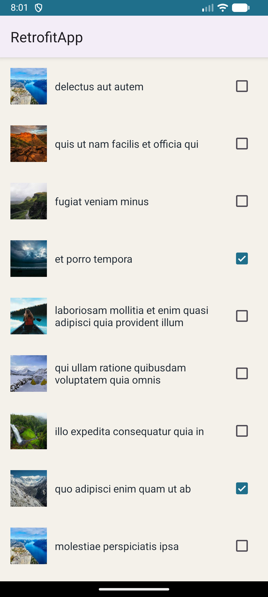
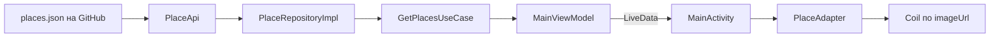
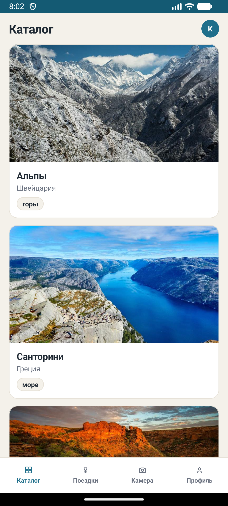

# Практическая работа № 5
### Сеть: Retrofit, Gson, Picasso

Язык реализации — **Kotlin**

| | |
|---|---|
| Студент | Корнилов Кирилл Юрьевич БСБО-09-23 |
| Учебный модуль | [`Practice5/RetrofitApp`](Practice5/RetrofitApp) |
| Пакет своего приложения | `ru.mirea.kornilov.sway` |

---

## Содержание

- [Что требовалось](#что-требовалось)
- [1. RetrofitApp: список дел](#1-retrofitapp-список-дел)
- [2. Обновление Todo по чекбоксу](#2-обновление-todo-по-чекбоксу)
- [3. Picasso](#3-picasso)
- [4. SWAY: каталог через Retrofit](#4-sway-каталог-через-retrofit)
- [Соответствие методичке](#соответствие-методичке)

---

## Что требовалось

| § | Задание | Где |
|---|---------|-----|
| 1 | Модуль `RetrofitApp`: список дел и статус выполнения с jsonplaceholder | [`Practice5/RetrofitApp`](Practice5/RetrofitApp) |
| 1 | При смене CheckBox отправить запрос на обновление Todo | `PATCH todos/{id}` |
| 2 | В ту же разметку добавить картинки из интернета через Picasso, с настройкой отображения | `TodoViewHolder` |
| Контрольное | Своё приложение: сущности из сети через Retrofit, ошибки, картинки Picasso / Coil / Glide | [`SWAY/`](SWAY/) |

Учебное приложение — отдельный проект, как модули практики 4:

```
Practice5/
└── RetrofitApp/     application, ru.mirea.kornilov.retrofitapp
```

Погода из мока, карточка места, гость и TensorFlow Lite — рамка курса, не это занятие.

---

## 1. RetrofitApp: список дел

Сервер — [jsonplaceholder.typicode.com](https://jsonplaceholder.typicode.com). Список `GET /todos`, около 200 записей. У каждой есть название и флаг `completed`.

Методичка просит три части: модель ответа, интерфейс запросов, объект Retrofit. Запрос нельзя делать на главном потоке через `execute()` — используется `enqueue`: сеть в фоне, ответ приходит в `Callback` уже на главном потоке.

### Зависимости и разрешение

```groovy
implementation 'com.squareup.retrofit2:retrofit:2.11.0'
implementation 'com.squareup.retrofit2:converter-gson:2.11.0'
implementation 'com.squareup.picasso:picasso:2.8'
implementation 'androidx.recyclerview:recyclerview:1.3.2'
```

В манифесте `android.permission.INTERNET`. Без него запрос падает в `onFailure`.

### Модель

Gson читает JSON в поля с теми же именами. `@SerializedName` фиксирует имена с сервера.

```kotlin
data class Todo(
    @SerializedName("userId") val userId: Int,
    @SerializedName("id") val id: Int,
    @SerializedName("title") val title: String,
    @SerializedName("completed") val completed: Boolean
)
```

### Интерфейс и клиент

`baseUrl` обязан заканчиваться на `/`. Аннотация `@GET("todos")` дописывается к нему: получается `https://jsonplaceholder.typicode.com/todos`.

```kotlin
interface ApiService {
    @GET("todos")
    fun getTodos(): Call<List<Todo>>

    @PATCH("todos/{id}")
    fun updateTodo(
        @Path("id") id: Int,
        @Body todo: Todo
    ): Call<Todo>
}
```

```kotlin
private const val BASE_URL = "https://jsonplaceholder.typicode.com/"

val retrofit = Retrofit.Builder()
    .baseUrl(BASE_URL)
    .addConverterFactory(GsonConverterFactory.create())
    .build()
apiService = retrofit.create(ApiService::class.java)
```

`GsonConverterFactory` сам превращает тело ответа в `List<Todo>`.

### Ответ и ошибки

`onResponse` вызывается, даже если сервер вернул 404: это не обрыв сети. Поэтому успех проверяется через `response.isSuccessful` (коды 200–299) и `body() != null`. Обрыв, неверный адрес и сбой разбора JSON попадают в `onFailure`.

```kotlin
apiService.getTodos().enqueue(object : Callback<List<Todo>> {
    override fun onResponse(call: Call<List<Todo>>, response: Response<List<Todo>>) {
        if (response.isSuccessful && response.body() != null) {
            todoAdapter.setItems(response.body()!!)
        } else {
            status.visibility = View.VISIBLE
            status.text = getString(R.string.load_error)
            Log.e(TAG, "onResponse: " + response.code())
        }
    }

    override fun onFailure(call: Call<List<Todo>>, t: Throwable) {
        status.visibility = View.VISIBLE
        status.text = getString(R.string.load_error)
        Log.e(TAG, "onFailure: " + t.message)
    }
})
```

На экране в этом случае текст «Не удалось загрузить список». Код ответа пишется в logcat.

### Список

`RecyclerView` + `LinearLayoutManager`. Строка `item_todo.xml` горизонтальная: картинка 56dp, название с весом 1, `CheckBox`.

```kotlin
todoAdapter = TodoAdapter { todo, checked -> updateTodo(todo, checked) }
recyclerView.layoutManager = LinearLayoutManager(this)
recyclerView.adapter = todoAdapter
```

<p align="center">
  
</p>

<p align="center">
  <sub>Начало списка. «et porro tempora» уже отмечено — так пришло в JSON, не с устройства.</sub>
</p>

---

## 2. Обновление Todo по чекбоксу

Второе задание раздела Retrofit: при смене галочки отправить обновление на сервер.

`@PATCH("todos/{id}")` подставляет id в путь. Тело — тот же `Todo`, у копии изменён только `completed`. Gson сериализует его обратно в JSON.

Слушатель чекбокса ставится **после** `isChecked = todo.completed`. Иначе `setChecked` при прокрутке списка сам вызвал бы `PATCH`.

```kotlin
completed.setOnCheckedChangeListener(null)
completed.isChecked = todo.completed
completed.setOnCheckedChangeListener { _, isChecked ->
    if (isChecked != todo.completed) {
        onChecked(todo, isChecked)
    }
}
```

```kotlin
private fun updateTodo(todo: Todo, checked: Boolean) {
    val updated = todo.copy(completed = checked)
    apiService.updateTodo(todo.id, updated).enqueue(object : Callback<Todo> {
        override fun onResponse(call: Call<Todo>, response: Response<Todo>) {
            if (response.isSuccessful) {
                todoAdapter.replace(updated)
            } else {
                todoAdapter.replace(todo)
                Toast.makeText(this@MainActivity, R.string.update_error, Toast.LENGTH_SHORT).show()
            }
        }

        override fun onFailure(call: Call<Todo>, t: Throwable) {
            todoAdapter.replace(todo)
            Toast.makeText(this@MainActivity, R.string.update_error, Toast.LENGTH_SHORT).show()
        }
    })
}
```

jsonplaceholder принимает `PATCH` и отвечает 200, но **не записывает** изменение. После перезапуска галочки снова как на сервере. Пока приложение открыто, `replace` держит новое значение в адаптере. Если код не 2xx или нет сети, в списке возвращается старый `Todo` и всплывает «Не удалось обновить дело».

---

## 3. Picasso

Задание раздела Picasso: в разметку прошлого экрана добавить изображение, загрузить несколько картинок из интернета и настроить параметры показа.

У дела на jsonplaceholder своей картинки нет. В строку добавлен `ImageView`. Адрес выбирается из восьми id picsum по остатку от `todo.id`, поэтому по списку фото повторяются, а не одно на все строки.

```kotlin
Picasso.get()
    .load(imageUrl(todo.id))
    .resize(168, 168)
    .centerCrop()
    .placeholder(R.drawable.bg_placeholder)
    .error(R.drawable.bg_error_image)
    .into(image)
```

| Вызов | Зачем |
|-------|--------|
| `resize(168, 168)` | Скачать и уменьшить до размера ячейки, не держать полный кадр в памяти |
| `centerCrop()` | Обрезать по центру, чтобы квадрат был заполнен. Без `resize` Picasso этот метод не принимает |
| `placeholder` | Серый квадрат, пока файл в пути |
| `error` | Тёмно-красный квадрат, если адрес не открылся |

Загрузка идёт в фоне. На скрине выше у каждой строки уже своя картинка.

---

## 4. SWAY: каталог через Retrofit

Контрольное: открыть своё приложение, получать сущности из сети через Retrofit, обработать ошибки, картинки — Picasso, Coil или Glide.

Каталог с практики 4 не переделывался. Раньше `ViewModelFactory` подставляла `MockNetworkApi`, и `getPlaces()` возвращал список сразу. Теперь места приходят по HTTP, а экран по-прежнему только подписывается на LiveData.

Retrofit не попадает в Activity и не попадает в domain. Он в модуле `data`.

| Слой | Что добавилось | Чего нет |
|------|----------------|----------|
| `domain` | `loadPlaces(onResult)`, `PlacesLoadResult`, `PlacesError` | Retrofit, `Call`, Gson |
| `data` | `PlaceApi`, разбор `PlaceDto` → `Place` | разметка, LiveData |
| `app` | статус загрузки в `MainViewModel` | адрес сервера, `enqueue` |



### Откуда JSON

Те же восемь мест, что были в моке: Альпы, Санторини, Киото, Чёрный лес, Лиссабон, Каппадокия, Байкал, Рейкьявик. Файл [`SWAY/data/src/main/assets/places.json`](SWAY/data/src/main/assets/places.json). Поля: `id`, `name`, `country`, `description`, `imageUrl`, `sceneType`.

Приложение не читает файл из assets. Retrofit забирает его с GitHub:

`https://raw.githubusercontent.com/krl76/MobileDevelopment2/main/SWAY/data/src/main/assets/places.json`

Пока этот путь не в ветке `main`, сервер отвечает не списком — на экране ошибка ответа, не пустой каталог «из воздуха».

```kotlin
interface PlaceApi {
    @GET("SWAY/data/src/main/assets/places.json")
    fun getPlaces(): Call<List<PlaceDto>>

    companion object {
        private const val BASE_URL =
            "https://raw.githubusercontent.com/krl76/MobileDevelopment2/main/"

        fun create(): PlaceApi {
            return Retrofit.Builder()
                .baseUrl(BASE_URL)
                .addConverterFactory(GsonConverterFactory.create())
                .build()
                .create(PlaceApi::class.java)
        }
    }
}
```

Фабрику ViewModel собирает так: `PlaceRepositoryImpl(PlaceApi.create())`. `Context` во ViewModel по-прежнему не передаётся.

### Репозиторий и use case

`enqueue` остаётся в `PlaceRepositoryImpl`. Успешный список мапится в domain и кладётся в кэш: `getPlaceById` и `getPlacesByScene` читают уже загруженные места, без второго запроса. `sceneType` из строки JSON переводится в enum, неизвестное значение становится `CITY`.

```kotlin
override fun loadPlaces(onResult: (PlacesLoadResult) -> Unit) {
    placeApi.getPlaces().enqueue(object : Callback<List<PlaceDto>> {
        override fun onResponse(call: Call<List<PlaceDto>>, response: Response<List<PlaceDto>>) {
            val body = response.body()
            if (response.isSuccessful && body != null) {
                val places = body.map { it.toDomain() }
                cache.clear()
                cache.addAll(places)
                onResult(PlacesLoadResult.Success(places))
            } else {
                onResult(PlacesLoadResult.Failure(PlacesError.BAD_RESPONSE))
            }
        }

        override fun onFailure(call: Call<List<PlaceDto>>, t: Throwable) {
            if (call.isCanceled) return
            onResult(PlacesLoadResult.Failure(PlacesError.NO_NETWORK))
        }
    })
}
```

`GetPlacesUseCase` только вызывает репозиторий. Коды HTTP и `Throwable` наружу не выходят — только `Success` или `Failure`.

### Экран

`MainViewModel` в `loadPlaces()` ставит статус «загрузка», потом по результату use case пишет список и статус в LiveData.

| `PlacesError` | Статус | Текст |
|---------------|--------|-------|
| — успех | `READY` | список, сообщение скрыто |
| `NO_NETWORK` | `NO_NETWORK` | «Нет сети. Проверь интернет и открой каталог снова.» |
| `BAD_RESPONSE` | `BAD_RESPONSE` | «Не удалось получить каталог с сервера.» |

Пока идёт запрос, по центру «Загрузка каталога…». Картинки карточек грузит Coil из поля `imageUrl` — методичка разрешает Picasso, Coil или Glide. Picasso оставлен в учебном модуле, в SWAY менять загрузчик не пришлось.

`MockNetworkApi` не удалён: погода по-прежнему заглушка. Каталог её не вызывает.

<p align="center">
  
</p>

<p align="center">
  <sub>После ответа: шапка «Каталог», карточки 16:9, чип сцены. Данные те же, источник — HTTP.</sub>
</p>

---
