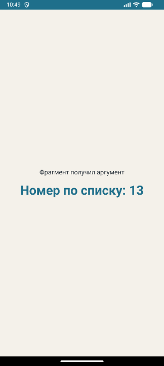
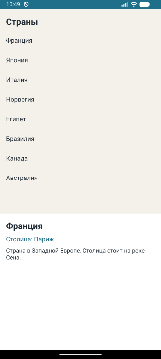
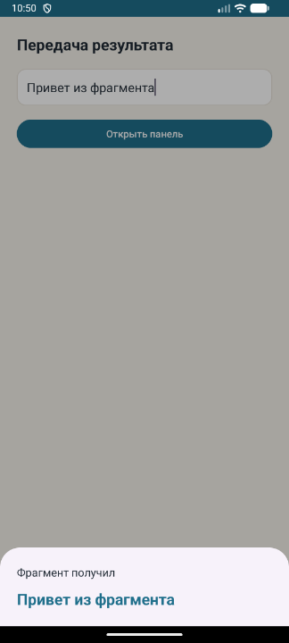
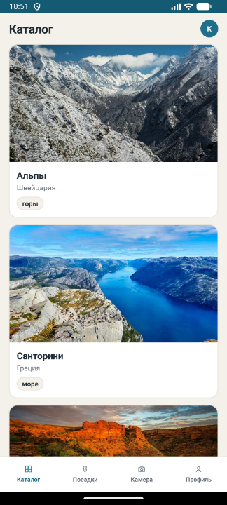
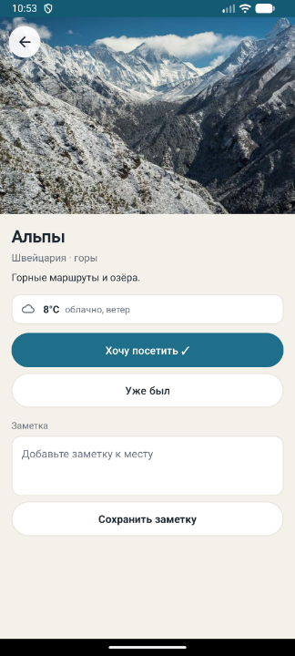
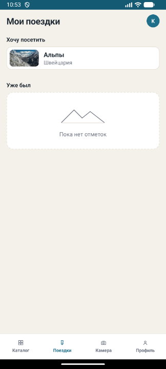
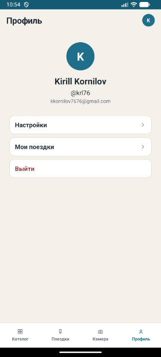
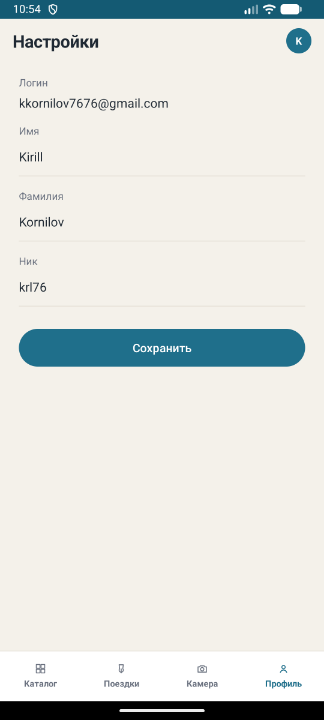
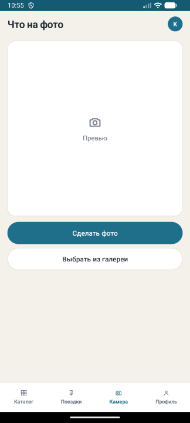
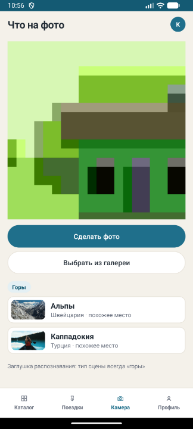

# Практическая работа № 6
### Фрагменты: транзакция, общая ViewModel, Fragment Result API

Язык реализации — **Kotlin**

| | |
|---|---|
| Студент | Корнилов Кирилл Юрьевич БСБО-09-23 |
| Учебные модули | [`Practice6/`](Practice6/) |
| Пакет своего приложения | `ru.mirea.kornilov.sway` |

---

## Содержание

- [Что требовалось](#что-требовалось)
- [1. FragmentApp: фрагмент и номер по списку](#1-fragmentapp-фрагмент-и-номер-по-списку)
- [2. FragmentManagerApp: список и подробности](#2-fragmentmanagerapp-список-и-подробности)
- [3. ResultApiFragmentApp: результат между фрагментами](#3-resultapifragmentapp-результат-между-фрагментами)
- [4. SWAY: каталог и профиль во фрагментах](#4-sway-каталог-и-профиль-во-фрагментах)
- [5. Карточка места](#5-карточка-места)
- [6. Поездки и свои отметки](#6-поездки-и-свои-отметки)
- [7. Профиль: ник, Firestore, настройки](#7-профиль-ник-firestore-настройки)
- [8. Гость](#8-гость)
- [9. Камера](#9-камера)
- [Соответствие](#соответствие)

---

## Что требовалось

| § | Задание | Где |
|---|---------|-----|
| 1 | Модуль `FragmentApp`: фрагмент в контейнере, номер по списку уходит во фрагмент через `Bundle` | [`Practice6/FragmentApp`](Practice6/FragmentApp) |
| 2 | Модуль `FragmentManagerApp`: список и экран подробностей, общая `ViewModel` на активность | [`Practice6/FragmentManagerApp`](Practice6/FragmentManagerApp) |
| 3 | Модуль `ResultApiFragmentApp`: текст из одного фрагмента в `BottomSheetDialogFragment` через Fragment Result API, ключ `requestKey` | [`Practice6/ResultApiFragmentApp`](Practice6/ResultApiFragmentApp) |
| Контрольное | Список прошлого занятия на `ViewModel` и нескольких фрагментах, фрагмент «Профиль» по данным авторизации, переходы с back stack | [`SWAY/`](SWAY/) |

Три учебных приложения — модули одного проекта, тот же стек, что у практики 5: AGP 8.5.2, Kotlin 1.9.24, `compileSdk` 34, `minSdk` 24, Java 17.

```
Practice6/
├── FragmentApp/              ru.mirea.kornilov.fragmentapp
├── FragmentManagerApp/       ru.mirea.kornilov.fragmentmanagerapp
└── ResultApiFragmentApp/     ru.mirea.kornilov.resultapifragmentapp
```

Во всех трёх модулях одна и та же зависимость фрагментов:

```groovy
implementation 'androidx.fragment:fragment-ktx:1.8.5'
```

`fragment-ktx` тянет за собой `fragment`. Отдельная строка `fragment` не нужна.

Серый прямоугольник в начале раздела повторяет «список дел» из практики 5. Рабочий пример того же раздела — пустой фрагмент и номер по списку. Сделан пример, второй Retrofit-список не собирался.

После контрольного минимума приложение доводилось до экранов из макета. Это разделы 5–9: карточка места, поездки, профиль в Firestore, гость и камера. В методичке практики 6 их отдельными пунктами нет. Они закрывают общую рамку курса: страница сущности, запись в базу, разные возможности гостя и пользователя, распознавание сцены.

---

## 1. FragmentApp: фрагмент и номер по списку

Активность больше не рисует содержимое сама. В разметке один контейнер. Атрибута `android:name` нет: фрагмент добавляется кодом. Если поставить и `android:name`, и транзакцию `add`, система создаст фрагмент дважды.

```xml
<androidx.fragment.app.FragmentContainerView
    android:id="@+id/fragment_container_view"
    android:layout_width="match_parent"
    android:layout_height="match_parent" />
```

Транзакция выполняется только при первом создании активности. После поворота `savedInstanceState` уже не `null`, фрагмент восстанавливает `FragmentManager`. Повторный `add` дал бы второй экземпляр поверх первого.

`setReorderingAllowed(true)` разрешает менеджеру выполнять операции транзакции в правильном порядке, когда несколько фрагментов меняются вместе. Для одного `add` это тот же вызов, что в методичке.

Номер лежит в константе `STUDENT_LIST_NUMBER`. Сейчас там **13**. Ключ аргумента — `my_number_student`, как в примере.

```kotlin
override fun onCreate(savedInstanceState: Bundle?) {
    super.onCreate(savedInstanceState)
    setContentView(R.layout.activity_main)
    if (savedInstanceState == null) {
        val bundle = Bundle()
        bundle.putInt(BlankFragment.ARG_STUDENT_NUMBER, STUDENT_LIST_NUMBER)
        supportFragmentManager.beginTransaction()
            .setReorderingAllowed(true)
            .add(R.id.fragment_container_view, BlankFragment::class.java, bundle)
            .commit()
    }
}
```

В примере методички `Bundle` создаётся, а третьим аргументом `add` передаётся `null`. Тогда `requireArguments()` падает: у фрагмента нет аргументов. Здесь в `add` уходит сам `bundle`. Сигнатура `add(containerId, fragmentClass, args)` как раз кладёт этот набор в `arguments` фрагмента.

Фрагмент наследует `androidx.fragment.app.Fragment`. Разметка создаётся в `onCreateView`. Номер читается в `onViewCreated`: к этому моменту `view` уже есть, а аргументы доступны через `requireArguments()`.

```kotlin
override fun onCreateView(
    inflater: LayoutInflater,
    container: ViewGroup?,
    savedInstanceState: Bundle?
): View {
    Log.d(BlankFragment::class.java.simpleName, "onCreateView")
    return inflater.inflate(R.layout.fragment_blank, container, false)
}

override fun onViewCreated(view: View, savedInstanceState: Bundle?) {
    super.onViewCreated(view, savedInstanceState)
    val numberStudent = requireArguments().getInt(ARG_STUDENT_NUMBER)
    Log.d(BlankFragment::class.java.simpleName, numberStudent.toString())
    view.findViewById<TextView>(R.id.textStudentNumber).text =
        getString(R.string.student_number, numberStudent)
}
```

На экране строка «Номер по списку: 13». В Logcat у тега `BlankFragment` две строки: `onCreateView` и `13`. После поворота число остаётся: фрагмент не создаётся заново, аргументы восстанавливаются вместе с ним.

<p align="center">
  
</p>

<p align="center">
  <sub>Фрагмент получил аргумент и показал номер 13.</sub>
</p>

---

## 2. FragmentManagerApp: список и подробности

Задание раздела Fragment Manager: несколько фрагментов, у первого список, у второго подробности выбранного пункта. Передача данных — общая `ViewModel`, привязанная к активности, а не к одному фрагменту. Тогда оба фрагмента видят один и тот же выбранный элемент, и он переживает поворот.

На главном экране два контейнера, снова без `android:name`. Список занимает большую часть, снизу панель подробностей. Оба фрагмента добавляются одной транзакцией, у каждого свой тег.

```kotlin
if (savedInstanceState == null) {
    supportFragmentManager.beginTransaction()
        .setReorderingAllowed(true)
        .add(R.id.list_container, CountriesFragment(), "header")
        .add(R.id.details_container, DetailsFragment(), "details")
        .commit()
}
```

Список — восемь стран в `RecyclerView`. По нажатию фрагмент не ищет соседа через `findFragmentByTag`. Он пишет страну в `ShareViewModel`:

```kotlin
class ShareViewModel : ViewModel() {
    private val selectedItem = MutableLiveData<Country?>()

    fun selectItem(item: Country) {
        selectedItem.value = item
    }

    fun getSelectedItem(): LiveData<Country?> = selectedItem
}
```

Оба фрагмента берут ViewModel так:

```kotlin
ViewModelProvider(requireActivity())[ShareViewModel::class.java]
```

`requireActivity()` — область жизни активности. Если вызвать `ViewModelProvider(this)` из фрагмента, у списка и у подробностей будут разные объекты, и выбор никуда не дойдёт.

`DetailsFragment` подписан на `viewLifecycleOwner`, не на сам фрагмент. Наблюдатель снимается вместе с разметкой и не течёт после уничтожения view.

```kotlin
val viewModel = ViewModelProvider(requireActivity())[ShareViewModel::class.java]
viewModel.getSelectedItem().observe(viewLifecycleOwner) { country ->
    Log.d(DetailsFragment::class.java.simpleName, country?.name ?: "empty")
    if (country == null) {
        nameView.setText(R.string.details_empty)
        capitalView.text = ""
        descriptionView.text = ""
    } else {
        nameView.text = country.name
        capitalView.text = getString(R.string.country_capital, country.capital)
        descriptionView.text = country.description
    }
}
```

Пока ничего не выбрано, внизу текст «Выберите страну». После нажатия — название, столица и короткое описание. В Logcat у тега `DetailsFragment` пишется имя страны. Поворот не сбрасывает выбор: `ShareViewModel` остаётся у активности.

<p align="center">
  
</p>

<p align="center">
  <sub>Список стран сверху, снизу подробности выбранной Франции.</sub>
</p>

`replace` и `addToBackStack` в этом модуле не используются. Методичка разрешает либо два фрагмента на одном экране, либо смену через `replace`. Здесь первый вариант: оба фрагмента видны сразу, и обновление подробностей видно без второго экрана. Back stack показан в SWAY, где это прямо требует контрольное задание.

---

## 3. ResultApiFragmentApp: результат между фрагментами

Fragment Result API передаёт `Bundle` один раз, без общей ViewModel и без того, чтобы фрагменты держали ссылки друг на друга. Получатель регистрирует слушатель на ключе. Отправитель кладёт результат под тем же ключом. Если слушателя ещё нет, менеджер хранит результат, пока слушатель не появится.

Экран — поле `editTextInfo` и кнопка `buttonOpenBottomSheet`. Они живут в `DataFragment`. Активность только кладёт этот фрагмент в контейнер при `savedInstanceState == null`.

По нажатию текст уходит в `childFragmentManager`, и сразу показывается нижняя панель. Панель — дочерний фрагмент `DataFragment`, поэтому её `parentFragmentManager` и есть тот же `childFragmentManager`. Слушатель и `setFragmentResult` смотрят в один менеджер. Если повесить слушатель на `supportFragmentManager` активности, результат до панели не дойдёт: это другой менеджер.

Ключ запроса — `requestKey`. Ключ строки внутри `Bundle` — `key`.

```kotlin
button.setOnClickListener {
    val text = view.findViewById<EditText>(R.id.editTextInfo).text.toString()
    val bundle = Bundle()
    bundle.putString(BottomSheetFragment.BUNDLE_KEY, text)
    childFragmentManager.setFragmentResult(BottomSheetFragment.REQUEST_KEY, bundle)
    BottomSheetFragment().show(childFragmentManager, "ModalBottomSheet")
}
```

`BottomSheetFragment` наследует `BottomSheetDialogFragment`. Слушатель ставится в `onCreate`, владельцем жизненного цикла указан сам фрагмент. Результат приходит, когда фрагмент доходит до состояния `STARTED`. К этому моменту view может уже существовать, а может ещё нет, поэтому текст запоминается в поле и ещё раз выставляется в `onViewCreated`.

```kotlin
override fun onCreate(savedInstanceState: Bundle?) {
    super.onCreate(savedInstanceState)
    parentFragmentManager.setFragmentResultListener(REQUEST_KEY, this) { _, bundle ->
        receivedText = bundle.getString(BUNDLE_KEY).orEmpty()
        Log.d(BottomSheetFragment::class.java.simpleName, "Get text $receivedText")
        view?.findViewById<TextView>(R.id.textResult)?.text = shownText(receivedText)
    }
}
```

На панели видно введённую строку. Пустое поле даёт текст «Пустая строка», чтобы было понятно, что панель открылась. В Logcat у тега `BottomSheetFragment` строка `Get text …`. Повторное нажатие кладёт новый результат и открывает новую панель: прошлый результат уже отдан слушателю и не копится.

<p align="center">
  
</p>

<p align="center">
  <sub>Нижняя панель получила строку «Привет из фрагмента».</sub>
</p>

---

## 4. SWAY: каталог и профиль во фрагментах

Контрольное задание: список из практики 5 остаётся на `ViewModel`, но рисуется фрагментом. Рядом фрагмент «Профиль» по данным авторизации. Переходы — `replace` с `addToBackStack`.

Зависимость та же, `fragment-ktx:1.8.5`, в модуле `app`. В `activity_main.xml` середина экрана — `FragmentContainerView` с id `fragment_container`, без `android:name`. Шапка и нижние вкладки остаются в активности: они общие для экранов.

При первом запуске в контейнер кладётся только каталог. Условие `savedInstanceState == null` то же, что в учебных модулях.

Каталог переехал из `MainActivity` в `CatalogFragment`. Фрагмент берёт `MainViewModel` у активности, поэтому список, статус загрузки и буква аватара — те же LiveData, что после Retrofit. Поворот и смена экрана не запускают новый запрос сами по себе: ViewModel переживает фрагмент.

Профиль — `ProfileFragment`. Он читает ту же `MainViewModel`: буква, имя, ник и почта приходят из `GetProfileUseCase` / `RefreshProfileUseCase`. Кнопка «Выйти» вызывает `LogoutUseCase`. Фрагмент не держит `FirebaseAuth` и не ходит в `SharedPreferences`.

Переход на профиль заменяет каталог и кладёт транзакцию в back stack:

```kotlin
supportFragmentManager.beginTransaction()
    .setReorderingAllowed(true)
    .replace(R.id.fragment_container, fragmentClass, null)
    .addToBackStack(null)
    .commit()
```

Корневой каталог в стек не кладётся. «Назад» снимает верхнюю транзакцию и возвращает предыдущий фрагмент. Вкладка «Каталог» снимает стек целиком, `POP_BACK_STACK_INCLUSIVE`, и снова виден список.

`CatalogFragment` при возврате заново проходит `onViewCreated` и снова подписывается на LiveData. Данные уже лежат во ViewModel, список не мигает пустым запросом, если места были загружены.

Шапка меняется вместе с фрагментом: на каталоге «Каталог», на профиле «Профиль». Активная вкладка подсвечивается из `OnBackStackChangedListener`, чтобы подсветка совпала со стеком, а не только с последним нажатием.

Буква в правом верхнем углу — та же, что на профиле. Нажатие на неё открывает профиль тем же `showProfile()`, что и нижняя вкладка. На карточке места шапка спрятана, поэтому там кружка нет.

<p align="center">
  
</p>

<p align="center">
  <sub>Каталог во фрагменте. Буква K в шапке открывает профиль.</sub>
</p>

---

## 5. Карточка места

Нажатие на карточку в каталоге открывает `PlaceFragment` поверх списка и кладёт переход в back stack. Во фрагмент уходит не id из кэша другого репозитория, а поля места аргументами: id, имя, страна, описание, адрес картинки, тип сцены. Иначе карточка зависела бы от того экземпляра `PlaceRepository`, который загрузил каталог. У `PlaceViewModel` свой репозиторий погоды и поездок, кэш каталога ему не нужен.

На экране фото 3:2, кнопка «Назад», название, строка «страна · сцена», описание из JSON каталога. Длинные тексты из макета в данные не входят: на карточке то, что пришло с сервера.

Погода — блок как в макете: белая плашка, рамка 1 dp, скругление 12 dp, иконка, температура, подпись. Для описания со словом «ясно» рисуется солнце `#C9842A`, иначе серое облако. У Альп это `8°C` и «облачно, ветер», у Санторини — `24°C` и «ясно». Источник по-прежнему `MockNetworkApi` через `GetWeatherUseCase`, отдельного погодного Retrofit нет.

```kotlin
val clear = weather.description.contains("ясно")
weatherIcon.setImageResource(if (clear) R.drawable.ic_sun else R.drawable.ic_cloud)
weatherTemp.text = getString(R.string.place_weather_temp, weather.temperatureC)
weatherView.text = weather.description
```

Кнопки «Хочу посетить» и «Уже был» пишут в Room через `SaveWantToVisitUseCase` и `MarkVisitedUseCase`. Повторное нажатие снимает отметку: репозиторий переворачивает флаг, а не ставит его только в `true`.

```kotlin
val current = currentTrip(placeId) ?: return false
tripDao.upsert(current.copy(wantToVisit = !current.wantToVisit))
```

Заметка сохраняется через `AddPlaceNoteUseCase`. Пустая строка тоже записывается и очищает старый текст. После нажатия клавиатура закрывается, под кнопкой появляется «Заметка сохранена». Пока поле в фокусе, наблюдатель поездки не затирает набранный текст.

На время карточки активность прячет шапку и вкладки. «Назад» на фото и системная кнопка делают `popBackStack()`.

<p align="center">
  
</p>

<p align="center">
  <sub>Альпы: фото, погода «8°C облачно, ветер», отметка «Хочу посетить».</sub>
</p>

---

## 6. Поездки и свои отметки

Экран `TripsFragment` открывают вкладка «Поездки» и строка «Мои поездки» в профиле. Заголовок — «Мои поездки». Два блока: «Хочу посетить» и «Уже был». Место попадает в блок, если у его поездки стоит соответствующий флаг. Оба флага сразу — место в обоих списках. Пустой блок — пунктирная плашка «Пока нет отметок».

Список мест берётся из `MainViewModel`: это уже загруженный каталог. Поездки читает `TripsViewModel` через `GetMyTripsUseCase` в `onStart`, поэтому возврат с карточки показывает свежие отметки. Строка снова открывает `PlaceFragment`.

Сначала таблица `trips` была одна на телефон: первичный ключ только `placeId`, второй аккаунт видел чужие галочки. Теперь ключ составной, `userId` + `placeId`. `userId` — это `uid` из Firebase Auth.

```kotlin
@Entity(tableName = "trips", primaryKeys = ["userId", "placeId"])
data class TripEntity(
    val userId: String,
    val placeId: Int,
    val wantToVisit: Boolean,
    val visited: Boolean,
    val note: String
)
```

`TripRepositoryImpl.create` берёт текущего пользователя в момент создания репозитория. Выборка и запись идут только с этим `uid`. Гость и пустой `uid` получают пустой список, запись не выполняется. База поднята с версии 1 до 2: старые строки без владельца перенесены с пустым `userId` и на экране больше не видны. Их нужно поставить заново.

<p align="center">
  
</p>

<p align="center">
  <sub>Альпы в «Хочу посетить». «Уже был» пустой.</sub>
</p>

---

## 7. Профиль: ник, Firestore, настройки

При регистрации, кроме почты и пароля, спрашиваются имя, фамилия и ник. Поля видны только в режиме «Зарегистрироваться».

Почта проверяется не списком в приложении. `createUserWithEmailAndPassword` отдаёт ошибку Firebase `ERROR_EMAIL_ALREADY_IN_USE`, если адрес уже есть. Код переводится в `AuthError.EMAIL_ALREADY_USED`, на экране текст «Эта почта уже зарегистрирована». Короткий пароль — `ERROR_WEAK_PASSWORD`, меньше 6 символов. Общая фраза про неверный логин остаётся для остальных отказов входа.

Ник, имя и фамилия не умещаются в Firebase Auth: там одно поле `displayName`. Они пишутся в Cloud Firestore, коллекция `users`, идентификатор документа — `uid`. Поля: `email`, `nickname`, `firstName`, `lastName`. Правила базы пускают читать и писать только свой документ.

```kotlin
firestore.collection(USERS).document(current.uid).set(profile)
    .addOnSuccessListener {
        cacheProfile(email, nickname.trim(), firstName.trim(), lastName.trim())
        onResult(null)
    }
```

`SharedPreferences` остаются копией, чтобы имя не мигало пустым, пока документ читается. `getCurrentUser()` сразу отдаёт кэш. `loadProfile` потом читает Firestore и обновляет экран. Если запись профиля при регистрации не удалась, сессия сбрасывается и на экране текст «Аккаунт почты создан, но профиль не записался в Firestore» плюс сообщение исключения. Аккаунт в Authentication при этом уже существует, повторная регистрация той же почты ответит, что адрес занят.

Буква в кружке берётся по порядку: первый символ ника, иначе имени, иначе почты, в верхнем регистре. Нет сессии — «?». Для `krl76` это **K**, не первая буква адреса.

На профиле сверху имя и фамилия, под ними `@ник`, ниже почта. Старый аккаунт без документа Firestore показывает только почту.

<p align="center">
  
</p>

<p align="center">
  <sub>Kirill Kornilov, ник krl76, почта. Ниже настройки, поездки и выход.</sub>
</p>

Смена ника, имени и фамилии — экран `SettingsFragment`, строка «Настройки» в профиле. Почта только для чтения. «Сохранить» вызывает `updateProfile`: тот же документ `users/{uid}` перезаписывается, кэш обновляется, `MainViewModel.showUser` заново выставляет букву и подписи. «Назад» возвращает в профиль.

<p align="center">
  
</p>

<p align="center">
  <sub>Почта только для чтения. Имя, фамилия и ник можно изменить.</sub>
</p>

---

## 8. Гость

На экране входа под ссылкой регистрации есть «Продолжить как гость». Это не отдельный аккаунт Firebase: открывается `MainActivity` без `currentUser`. `authorized` в `MainViewModel` равен `user != null`, у гостя он ложный.

Каталог тот же, шапка без кружка. Карточка места открывается. Кнопки «Хочу посетить» и «Уже был» выключены, непрозрачность 0.42, как `is-disabled` в макете. Заметки нет, под кнопками «Войдите, чтобы сохранить».

Профиль гостя: серый кружок, заголовок «Гость», подпись «Просмотр каталога без сохранения», кнопки «Войти» и «Зарегистрироваться». «Войти» открывает обычную форму, «Зарегистрироваться» — ту же форму сразу в режиме регистрации. Гостевая `MainActivity` при этом закрывается, чтобы после входа под ней не остался чужой стек.

Вкладки «Поездки» и «Камера» серые, с замочком. Нажатие не меняет фрагмент и показывает «Войдите, чтобы открыть этот раздел». У вошедшего пользователя замочков нет.

---

## 9. Камера

Вкладка «Камера» у вошедшего пользователя открывает `CameraFragment`. Заголовок «Что на фото». Квадратное превью, «Сделать фото» и «Выбрать из галереи».

Снимок пишется в кэш приложения и отдаётся камере через `FileProvider`, authority `${applicationId}.fileprovider`. Перед съёмкой запрашивается `CAMERA`. Галерея открывается через `PickVisualMedia`, отдельное разрешение на чтение хранилища не нужно: контракт даёт временный `Uri`.

После картинки вызывается `RecognizePlaceUseCase` на том же `PlaceRepository`, что загрузил каталог. Иначе `getPlacesByScene` смотрел бы в пустой кэш другого экземпляра.

```kotlin
fun execute(): Pair<SceneType, List<Place>> {
    val scene = recognitionRepository.classifyScene()
    return scene to placeRepository.getPlacesByScene(scene)
}
```

`RecognitionRepositoryImpl.classifyScene()` всегда возвращает `SceneType.MOUNTAINS`. Модели TensorFlow Lite в проекте нет, практики её не подключали. Поэтому чип всегда «Горы», а в списке места каталога с типом гор: Альпы и Каппадокия. Под списком это написано: «Заглушка распознавания: тип сцены всегда „горы“». Нажатие на строку открывает карточку места. У гостя вкладка по-прежнему закрыта.

<p align="center">
  
</p>

<p align="center">
  <sub>Экран до снимка: превью, «Сделать фото» и «Выбрать из галереи».</sub>
</p>

<p align="center">
  
</p>

<p align="center">
  <sub>После снимка чип «Горы» и похожие места: Альпы и Каппадокия.</sub>
</p>

---
